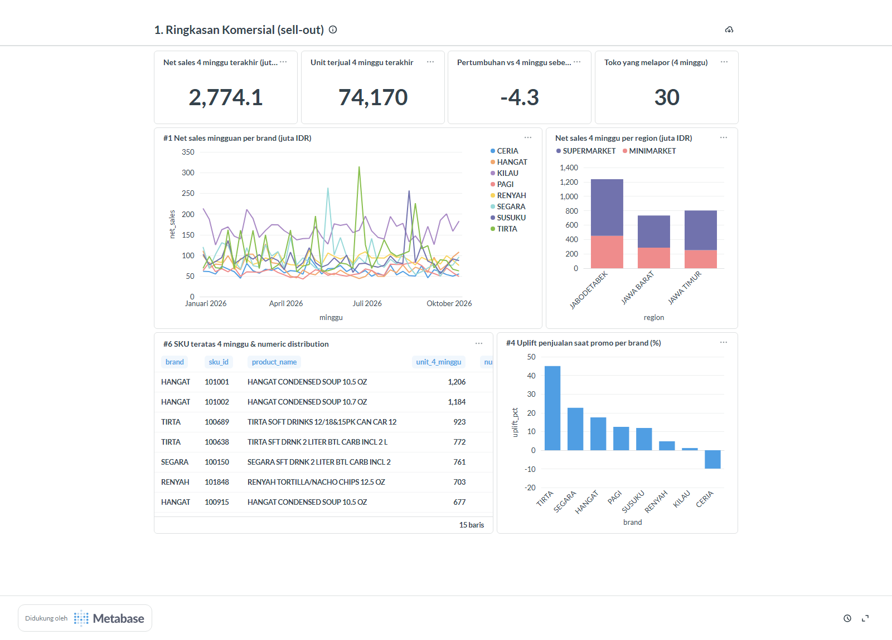
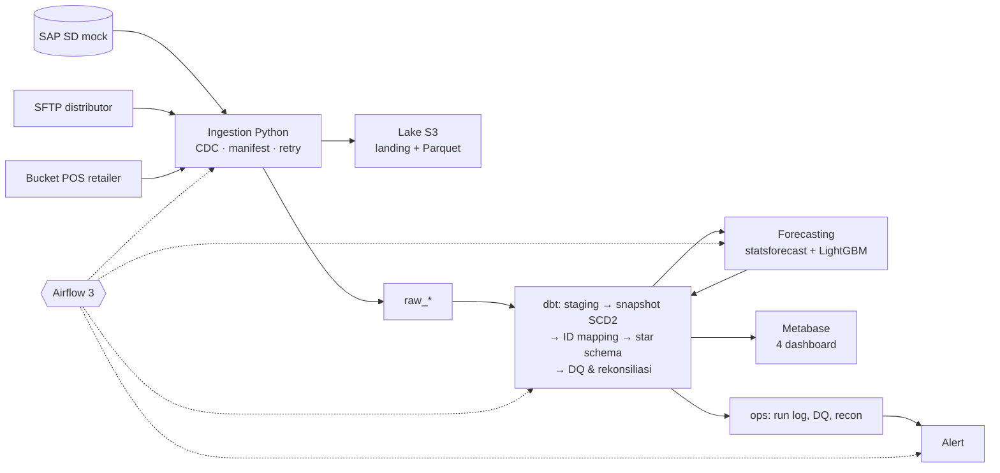
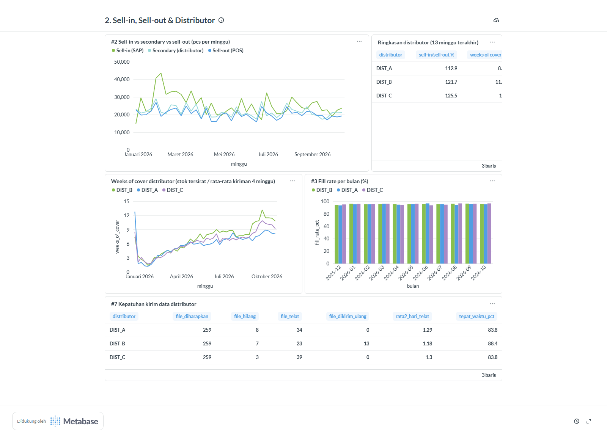
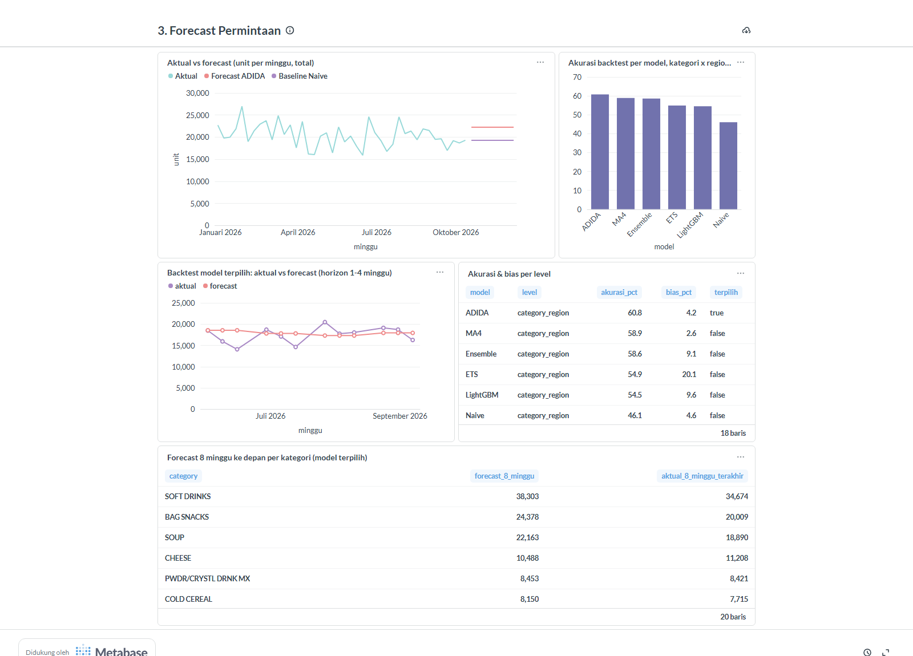
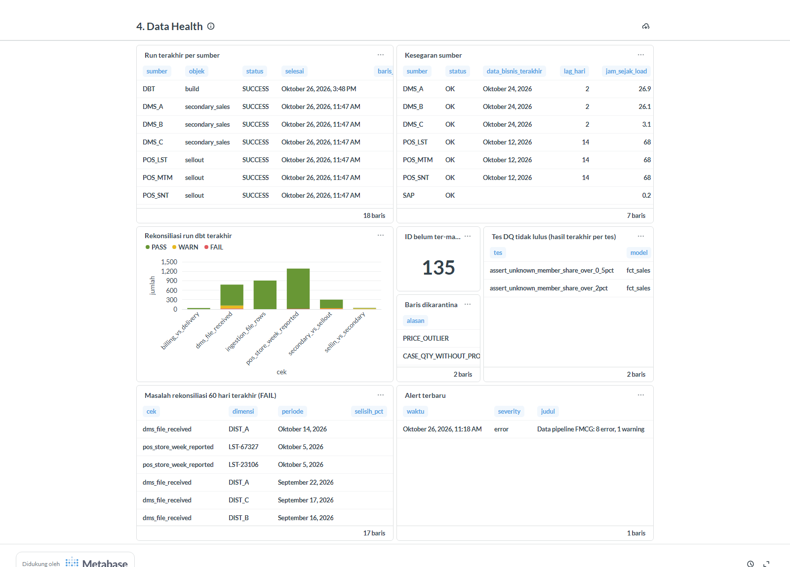

# FMCG Commercial Data Platform

Platform data komersial FMCG end-to-end:
- **Sumber:** SAP (sell-in), distributor (secondary), dan POS retailer (sell-out).
- **Alur:** data lake → warehouse (dbt) → dashboard Metabase + forecast permintaan.
- **Operasional:** diorkestrasi Airflow, dilengkapi data quality, rekonsiliasi, dan alerting.

Ketiga sistem sumber disimulasikan **lengkap dengan masalah data dunia nyata**, dan setiap masalah dibuktikan tertangkap oleh pipeline.

**Skenario:** principal fiktif *PT Nusantara Consumer Goods* (8 brand makanan & household) menjual ke 3 distributor, yang lalu mengirim ke 30 toko milik 3 retailer modern di Jawa. Data dasarnya dari dunnhumby *The Complete Journey*, dengan tanggal digeser ke 2025-12-28 s/d 2026-12-27.



## Hasil utama

| Aspek | Hasil (terverifikasi otomatis terhadap kebenaran simulator) |
|---|---|
| Deteksi masalah data | File distributor hilang **18/18**, toko tidak lapor POS **12/12**, tanpa alarm palsu; semua periode rekonsiliasi yang FAIL punya penyebab terbukti |
| Integrasi ID antar sistem | **0 salah map** dari 6.446 kode produk distributor dan 30 toko; cakupan nilai penjualan 98,3–100% |
| Idempotensi | Backfill 1 bulan (24 run, 442 run objek) memuat **0 baris** baru; isi warehouse identik sebelum dan sesudahnya. Incremental = full-refresh (hash MD5 sama) |
| Akurasi metrik | Fill rate di mart = kebenaran simulator (selisih < 1e-9); qty & nilai secondary per hari = kebenaran |
| Forecast | ADIDA terpilih lewat backtest 4 lipatan: akurasi **60,8%** (1−WAPE, kategori × region) vs baseline MA4 58,9% dan Naive 46,1% |
| Tes | 49 tes Python (unit + integrasi) dan 130 tes dbt |

## Arsitektur



Rincian ada di [docs/architecture.md](docs/architecture.md), dan keputusan yang menyimpang dari rencana di [docs/adr/](docs/adr/).

| Fungsi | Teknologi |
|---|---|
| Sistem sumber | PostgreSQL (SAP SD mock), atmoz/sftp, SeaweedFS (S3) |
| Ingestion | Python: psycopg, paramiko, boto3, pandas/pyarrow |
| Warehouse & transformasi | PostgreSQL 16, dbt Core 1.11 + dbt_utils |
| Orkestrasi | Apache Airflow 3.3 (LocalExecutor) |
| Forecasting | statsforecast, mlforecast, LightGBM |
| BI | Metabase 0.63 (dashboard as code lewat API) |
| Infrastruktur | Docker Compose, semua port hanya di localhost |

## Masalah data yang disimulasikan

Semua masalah bisa diatur di [simulation.yaml](simulators/config/simulation.yaml), dan hasilnya selalu sama untuk `seed` yang sama.

- **SAP:**
  - leading zero di `KUNNR`/`MATNR`
  - qty order diubah setelah dibuat (`AEDAT`), item direject (`ABGRU`), delivery parsial, goods issue tercatat belakangan
  - satuan CS vs EA
  - invoice dibatalkan (`FKSTO`/S1) lalu ditagih ulang
  - material pindah material group
- **Distributor:**
  - 3 format file (CSV `;` dengan desimal koma, Excel, pipe-delimited)
  - kode produk/outlet lokal
  - file telat, hilang, atau dikirim ulang dengan koreksi
  - karton vs PCS
  - kolom berganti nama di tengah tahun (schema drift)
- **POS:**
  - kode toko & artikel versi retailer
  - EAN kehilangan leading zero
  - baris dobel, retur negatif, harga outlier
  - toko tidak lapor seminggu

Pemetaan setiap masalah ke cek yang menangkapnya ada di [docs/data_quality.md](docs/data_quality.md).

## Cara menjalankan

Prasyarat: Docker Desktop dan Python 3.11. Seluruh stack memakai ±2,7 GB RAM saat idle (lebih tinggi saat dbt/forecast berjalan; sediakan ±4 GB untuk Docker).

```powershell
# 1. Persiapan
python -m venv .venv
.venv\Scripts\pip install -r requirements.txt
.venv\Scripts\python scripts\init_env.py           # .env dengan password & secret acak
.venv\Scripts\python scripts\download_data.py      # dataset ±14 MB dari GitHub

# 2. Infrastruktur (build image Airflow pertama ±10 menit)
docker compose up -d

# 3. Isi sistem sumber dengan data simulasi s/d kemarin
.venv\Scripts\python -m simulators generate
.venv\Scripts\python -m simulators publish

# 4. Pipeline (manual; di produksi dijalankan Airflow)
.venv\Scripts\python -m ingestion migrate
.venv\Scripts\python -m ingestion all
.venv\Scripts\python scripts\run_dbt.py deps
.venv\Scripts\python scripts\run_dbt.py build
.venv\Scripts\python -m forecasting.train_backtest
.venv\Scripts\python scripts\run_dbt.py build --select path:models/marts/forecast

# 5. Dashboard
.venv\Scripts\python -m dashboards.metabase.provision
```

| UI | URL | Login |
|---|---|---|
| Metabase | http://localhost:3000 | `METABASE_ADMIN_EMAIL` / `METABASE_ADMIN_PASSWORD` di `.env` |
| Airflow | http://localhost:8080 | tanpa login (lokal saja) |

Setelah itu Airflow menjalankan semuanya terjadwal: simulator 05:00, pipeline harian 06:00, forecast setiap Senin 08:00, dan rekonsiliasi penuh setiap Minggu 03:00.

## Komponen

### Simulator ([simulators/](simulators/))
Sell-out dunnhumby diubah menjadi rantai pasok lengkap:
1. Kiriman distributor ke toko 2x seminggu.
2. Order mingguan distributor ke principal, dengan simulasi stok distributor.
3. Order → delivery → invoice di SAP.

`publish --until <tanggal>` hanya mengirim data yang sudah "terjadi" sampai tanggal itu, termasuk perubahan dokumen lama dan file yang telat, jadi pipeline diuji seperti di dunia nyata.

### Ingestion ([ingestion/](ingestion/))
| Sumber | Cara | Idempotensi |
|---|---|---|
| SAP master | Full extract | Hanya baris dengan hash baru yang dimuat → `raw_sap` jadi log perubahan |
| SAP dokumen (VBAK/LIKP/VBRK + item) | CDC pada `greatest(ERDAT, AEDAT)`, lookback 3 hari, keyset pagination | Header + item + watermark dalam satu transaksi |
| Distributor (SFTP), POS (S3) | Per file | `ops.file_manifest` (SHA-256); kiriman ulang = `version` baru; kontrak skema → `REJECTED` |

Ingestion juga punya retry dengan exponential backoff + jitter, run log per objek, file asli disimpan di `landing/`, dan hasil parse dalam Parquet di `raw/`.

### Transformasi ([dbt/](dbt/))
| Schema | Isi |
|---|---|
| `staging` (17) | 1:1 dengan sumber: versi terbaru, tanggal DATS, leading zero, base UoM, versi file terakhir, dedup, EAN diperbaiki |
| `snapshots` | SCD Type 2 untuk material & customer |
| `intermediate` | Cross-reference ID produk/toko/distributor (kunci, EAN, mapping manual MDM, nama ternormalisasi), konversi karton → PCS |
| `marts` | `fct_sales`, `fct_shipment`, `fct_primary_sales`, `fct_forecast`, 5 dimensi, scorecard distributor, 6 rekonsiliasi |
| `ops` | ID belum ter-mapping, cakupan mapping, karantina, freshness, anomali volume |

Setiap run mencatat hasil tes ke `ops.dq_results` dan hasil rekonsiliasi ke `ops.recon_results`. Kamus data ada di [docs/data_dictionary.md](docs/data_dictionary.md), dan lineage bisa dilihat dengan `python scripts/run_dbt.py docs serve`.

Pertanyaan bisnis (PLAN 2.7) dijawab query di [dbt/analyses/](dbt/analyses/) (`python scripts/run_analysis.py`).

### Forecasting ([forecasting/](forecasting/))
**Setup:**
- Unit sell-out mingguan per SKU × region, horizon 8 minggu.
- Backtest rolling-origin 4 lipatan × 8 minggu.
- Model: Naive, MA4, AutoETS, ADIDA, LightGBM global, dan Ensemble.
- Model terpilih adalah yang WAPE-nya terendah di level kategori × region.

**Catatan jujur atas hasilnya:**
- Data per SKU sangat intermittent (median seri hanya laku 4 dari 42 minggu). Karena itu metode sederhana untuk demand intermittent (ADIDA) mengalahkan ETS dan LightGBM.
- Croston dicoba tapi dibuang karena over-forecast +155%.
- Fitur harga/promo masa depan tidak dipakai, karena nilainya belum diketahui saat forecast dibuat. Rencana promo baru tersedia setelah CRM masuk di fase 2.

| Model | Akurasi kategori × region | Bias |
|---|---|---|
| **ADIDA (terpilih)** | **60,8%** | +4,2% |
| MA4 (baseline) | 58,9% | +2,6% |
| Ensemble | 58,6% | +9,1% |
| ETS | 54,9% | +20,1% |
| LightGBM | 54,5% | +9,6% |
| Naive (baseline) | 46,1% | +4,6% |

### Orkestrasi, monitoring & alerting
| DAG | Jadwal (WIB) | Isi |
|---|---|---|
| `simulate_source_systems` | 05:00 | Simulator (bukan bagian pipeline produksi) |
| `daily_commercial_pipeline` | 06:00 | migrate → extract SAP / DMS / POS paralel → `dbt build` → `notify` |
| `forecast_weekly` | Senin 08:00 | fitur → backtest + forecast → model forecast + sanity test → `notify` |
| `weekly_reconcile` | Minggu 03:00 | Re-extract penuh SAP → `dbt build --full-refresh` → `notify` |

**Perilaku saat ada masalah:**
- Task di-retry 2x dengan backoff, lalu callback mengirim alert.
- dbt dari DAG mana pun berjalan bergiliran (pool 1 slot).
- `notify` meringkas task gagal, tes WARN/FAIL, rekonsiliasi FAIL, dan sumber terlambat. Masalah yang sama tidak dikirim ulang.
- Alert dicatat ke `ops.alert_log`, dan dikirim ke Discord/Slack bila `ALERT_WEBHOOK_URL` diisi.

Langkah penanganan setiap jenis alert ada di [docs/runbook.md](docs/runbook.md).

### Dashboard ([dashboards/metabase/](dashboards/metabase/))
Ada 4 dashboard yang dibuat ulang dari [spec.py](dashboards/metabase/spec.py), dan setiap kartu divalidasi saat provisioning:

| Dashboard | Isi |
|---|---|
| Ringkasan Komersial | KPI, tren per brand, region, SKU teratas, numeric distribution, uplift promo |
| Sell-in, Sell-out & Distributor | Sell-in vs secondary vs sell-out, weeks of cover, fill rate, kepatuhan kirim data |
| Forecast Permintaan | Aktual vs forecast, akurasi & bias per model, backtest |
| Data Health | Run terakhir, kesegaran sumber, rekonsiliasi, tes gagal, ID belum ter-mapping, karantina, alert |

| | |
|---|---|
|  |  |
|  | |

## Tes

```powershell
.venv\Scripts\python -m pytest                              # unit + invariant data
$env:RUN_INTEGRATION="1"; .venv\Scripts\python -m pytest   # + integrasi (butuh stack berjalan)
```

**Tes integrasi:**
- Ingestion 2x tidak membuat data dobel, rollback watermark saat gagal, dan resume SFTP setelah koneksi putus. Tes ini memakai database `dwh_test` dan bucket `lake-test`.
- Hasil dbt dicocokkan dengan kebenaran simulator: mapping, qty per hari, deteksi chaos, fill rate.
- Monitoring dan dedup alert.

`test_integration_publish.py` me-reset sistem sumber lalu memulihkannya. Jangan jalankan tes ini saat pipeline sedang berjalan.

## Struktur repo

```
simulators/      sistem sumber tiruan + chaos (SAP, SFTP distributor, bucket POS)
ingestion/       extractor, kontrak skema, manifest, watermark, retry, migrasi warehouse
warehouse/       migrasi SQL (raw, ops, forecast, role BI)
dbt/             staging, snapshots, intermediate, marts, ops, tes, analyses
forecasting/     fitur, model, backtest, simpan forecast
monitoring/      ringkasan masalah & pengiriman alert
orchestration/   image & DAG Airflow
dashboards/      spesifikasi & provisioning Metabase
docs/            PLAN, arsitektur, ADR, data quality, runbook, kamus data
tests/           pytest (unit & integrasi)
```

## Keterbatasan & langkah berikutnya

- **Fase 2:** CRM (akun, kunjungan, rencana promo) dan syndicated market data (market share, PLAN 2.7 #5).
- **Data dasar hanya 1 tahun**, sehingga belum ada pembanding year-on-year maupun seasonal naive tahunan.
- **Riwayat SCD2 baru tercatat sejak pipeline dipasang.** Perubahan master sebelum itu tidak pernah terekstrak.
- **Lingkungan lokal saja:** Airflow tanpa login dan kredensial dev di `.env`. Untuk deployment perlu secret manager, autentikasi, dan TLS.

## Sumber data

dunnhumby *The Complete Journey*, diambil lewat paket R [`completejourney`](https://github.com/bradleyboehmke/completejourney) (lisensi CC0). Semua nama perusahaan, brand, distributor, dan retailer dalam project ini fiktif.
