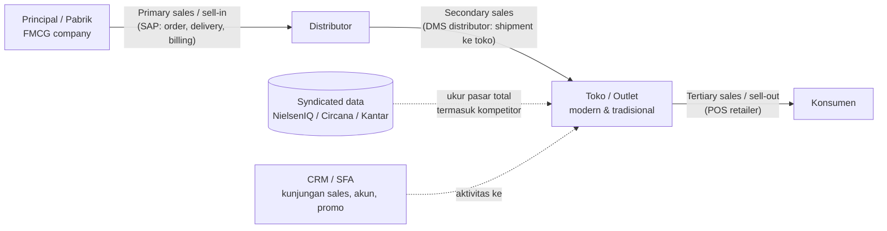
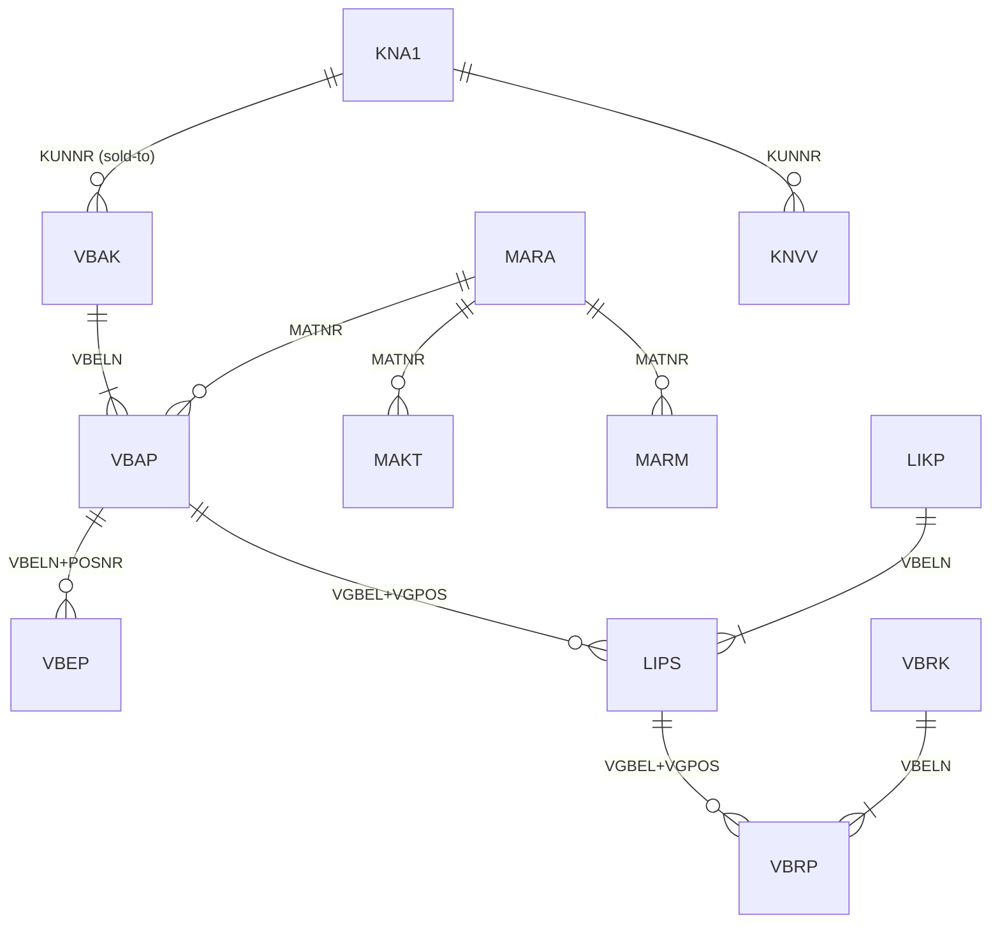
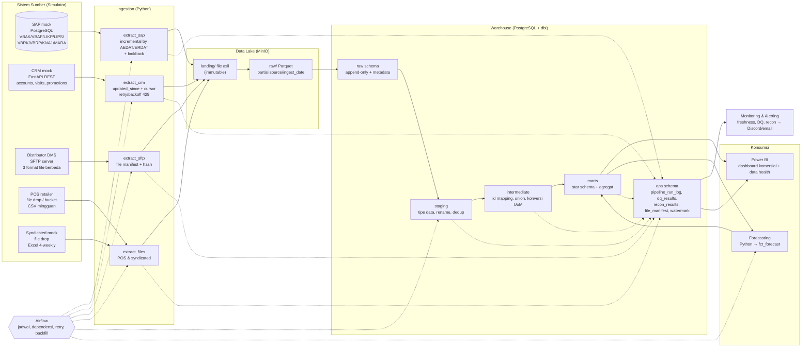
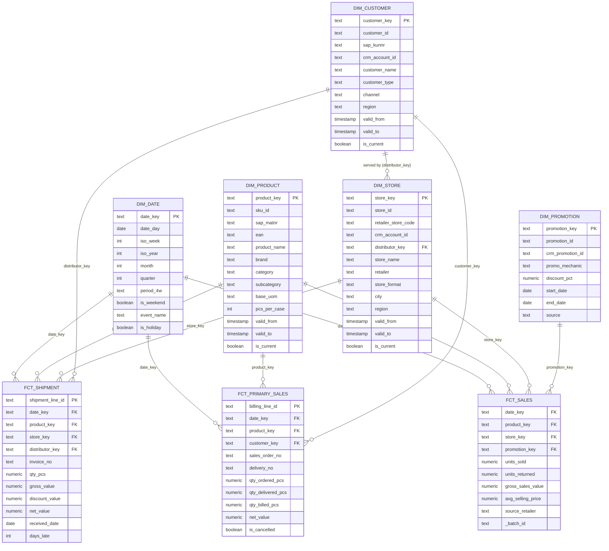
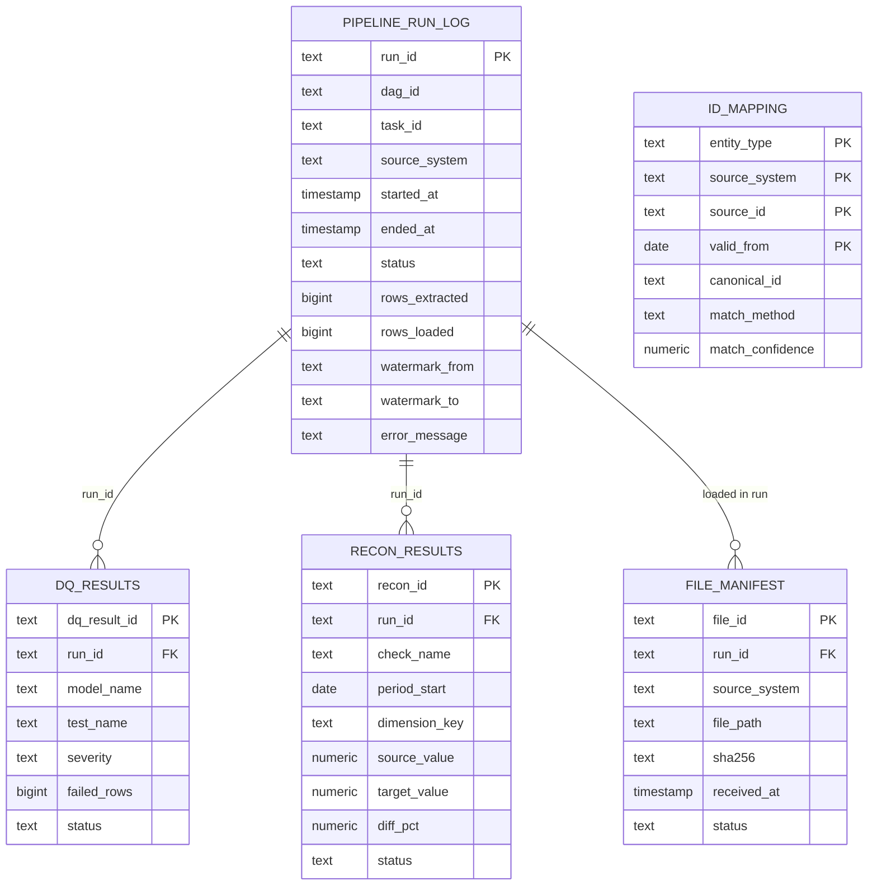
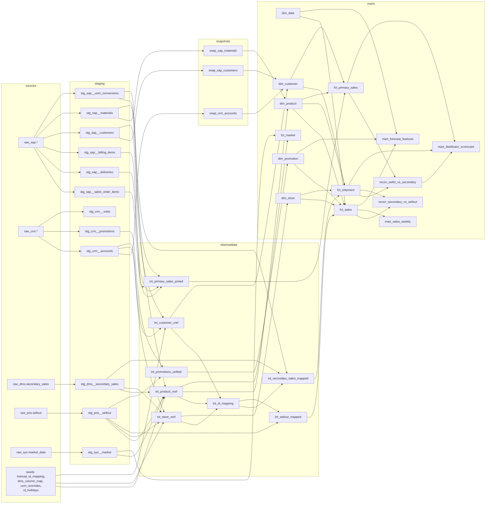

# FMCG Commercial Data Platform — Riset & Rencana

> Status: **Disetujui 2026-10-23** (lihat "Keputusan final" di akhir). Milestone 1–6 (MVP) selesai. Hasil & penyimpangan dari rencana: README, docs/architecture.md, docs/adr/.
> Tujuan: project portofolio Data Engineer (FMCG/retail) yang meniru pipeline data komersial nyata: SAP, CRM, POS, distributor, syndicated market data → warehouse → dashboard + forecasting.

**Cara membaca label:**
- **[FAKTA]** = praktik/struktur yang terdokumentasi publik (lihat Referensi di bagian 1.5).
- **[ASUMSI]** = perkiraan saya tentang praktik umum, atau pilihan desain untuk project ini. Bisa berbeda di tiap perusahaan.

Daftar isi:
1. [Tahap 1 — Riset](#tahap-1--riset)
2. [Tahap 2 — Perencanaan End-to-End](#tahap-2--perencanaan-end-to-end)
3. [Tahap 3 — Pemetaan ke Job Desc](#tahap-3--pemetaan-ke-job-desc)
4. [Keputusan yang Perlu Dipilih](#keputusan-yang-perlu-dipilih)

---

## Tahap 1 — Riset

### 1.0 Konsep dasar: alur penjualan di FMCG

Di FMCG, satu produk "terjual" tiga kali, dan tiap tahap datanya ada di sistem berbeda. Ini inti dari kenapa integrasi data komersial itu sulit.



- **Primary sales (sell-in)** — perusahaan menjual ke distributor. Sumber: ERP (SAP SD). **[FAKTA]**
- **Secondary sales** — distributor mengirim ke toko. Sumber: Distributor Management System (DMS) milik distributor, dikirim ke principal. **[FAKTA umum di industri; format detail ASUMSI]**
- **Tertiary sales (sell-out)** — toko menjual ke konsumen. Sumber: POS retailer, dibagikan oleh retailer modern (supermarket/minimarket). **[FAKTA]**
- **Syndicated data** — data pasar dari pihak ketiga (mis. NielsenIQ, Circana, Kantar) yang mengukur penjualan seluruh pasar termasuk kompetitor. **[FAKTA]**

Selisih antara ketiga tahap ini (mis. sell-in naik tapi sell-out turun = stok menumpuk di distributor) adalah salah satu analisis paling penting di FMCG.

---

### 1.1 Cara perusahaan mengambil data dari tiap sumber

| Sumber | Metode ekstraksi yang umum | Format | Frekuensi umum | Label |
|---|---|---|---|---|
| **SAP ECC / S/4HANA (ERP)** | (a) **ODP / delta queue** (Operational Data Provisioning) lewat extractor BW (mis. `2LIS_11_VAITM` untuk item sales order) atau CDS view; (b) **SLT** (replikasi trigger-based, mendekati real-time); (c) **OData** service; (d) RFC/BAPI, termasuk `RFC_READ_TABLE` (terbatas, tidak cocok untuk volume besar); (e) tool pihak ketiga (Fivetran, Azure Data Factory SAP CDC, Qlik Replicate); (f) export file terjadwal | Tabel relasional, IDoc, JSON (OData), CSV | Harian (batch malam) atau tiap 15–60 menit (delta) | [FAKTA] metode; [ASUMSI] frekuensi |
| **CRM / SFA** (mis. Salesforce, MS Dynamics 365, atau aplikasi SFA lokal) | REST API dengan filter `LastModifiedDate`/`SystemModstamp` (incremental), Bulk API untuk volume besar, endpoint khusus untuk record terhapus | JSON | Per jam s/d harian | [FAKTA] untuk Salesforce/Dataverse |
| **POS retailer (sell-out)** | Retailer berbagi data lewat **portal** (contoh terkenal: Walmart Retail Link), **SFTP/email** file, atau **EDI 852** (Product Activity Data) di pasar AS | CSV / Excel / EDI | Harian atau mingguan | [FAKTA] untuk contoh yang disebut; [ASUMSI] untuk retailer Indonesia (umumnya file via portal/email) |
| **Distributor (DMS)** | Distributor upload file ke **SFTP** principal, atau principal menarik dari **API DMS**, atau lewat aplikasi DMS yang disediakan principal | CSV/Excel dengan format berbeda-beda per distributor | Harian (D+1) atau mingguan | [ASUMSI, berdasar praktik umum] |
| **Customer master** | Dari SAP (`KNA1`, `KNVV`) + CRM, kadang lewat tool MDM (Master Data Management) | Tabel / API | Harian, atau event saat ada perubahan | [FAKTA] tabel SAP; [ASUMSI] alur MDM |
| **Syndicated market data** | File dari vendor (portal download / SFTP / data feed), berisi hierarki pasar, kategori, brand | Excel/CSV lebar (periode sebagai kolom), atau feed terstruktur | Mingguan, 4-mingguan, atau bulanan; sering ada **restatement** (data periode lama direvisi) | [FAKTA] vendor & restatement; [ASUMSI] format detail |

**Catatan penting SAP [FAKTA, perlu dicek ulang]:** SAP Note 3255746 (2024) menyatakan penggunaan API ODP via RFC oleh aplikasi pihak ketiga tidak diizinkan/didukung. Artinya di dunia nyata, perusahaan makin diarahkan ke jalur resmi SAP (Datasphere, OData/CDS). Untuk project ini tidak berpengaruh karena kita mensimulasikan.

---

### 1.2 Tabel/struktur data inti tiap sumber

#### SAP SD (Sales & Distribution) — [FAKTA]

| Tabel | Isi | Kolom kunci penting |
|---|---|---|
| `VBAK` | Header sales order | `VBELN` (no. dokumen), `AUART` (tipe order), `ERDAT` (tgl dibuat), `AEDAT` (tgl diubah), `KUNNR` (sold-to customer), `VKORG` (sales org), `VTWEG` (channel), `NETWR`, `WAERK` (currency) |
| `VBAP` | Item sales order | `VBELN`, `POSNR` (no. item), `MATNR` (material), `KWMENG` (qty order), `VRKME` (satuan), `NETWR`, `WERKS` (plant), `ABGRU` (alasan reject) |
| `VBEP` | Schedule line (jadwal kirim) | `VBELN`, `POSNR`, `ETENR`, `EDATU`, `BMENG` (qty dikonfirmasi) |
| `LIKP` | Header delivery | `VBELN` (no. delivery), `LFART`, `KUNNR` (ship-to), `WADAT_IST` (tgl goods issue aktual) |
| `LIPS` | Item delivery | `VBELN`, `POSNR`, `MATNR`, `LFIMG` (qty dikirim), `VGBEL`/`VGPOS` (referensi ke sales order) |
| `VBRK` | Header billing (invoice) | `VBELN`, `FKART`, `FKDAT` (tgl billing), `KUNAG` (payer/sold-to), `NETWR`, `FKSTO` (flag dibatalkan) |
| `VBRP` | Item billing | `VBELN`, `POSNR`, `MATNR`, `FKIMG` (qty), `NETWR`, `AUBEL` (ref sales order), `VGBEL` (ref delivery) |
| `VBFA` | Document flow (rantai dokumen) | `VBELV` (dokumen asal) → `VBELN` (dokumen tujuan) |
| `KNA1` | Customer master (umum) | `KUNNR`, `NAME1`, `LAND1`, `REGIO`, `ORT01`, `KTOKD` (grup akun) |
| `KNVV` | Customer per sales area | `KUNNR`, `VKORG`, `VTWEG`, `SPART`, `KDGRP` (grup customer) |
| `MARA` | Material master (umum) | `MATNR`, `MTART` (tipe), `MATKL` (grup), `MEINS` (satuan dasar), `EAN11` (barcode) |
| `MAKT` | Deskripsi material | `MATNR`, `SPRAS` (bahasa), `MAKTX` |
| `MARM` | Konversi satuan | `MATNR`, `MEINH` (satuan alternatif, mis. CS=karton), `UMREZ`/`UMREN` (faktor) |



Kebiasaan SAP yang menjebak **[FAKTA]**: `KUNNR` dan `MATNR` disimpan dengan **leading zero** (mis. `0000012345`) karena konversi ALPHA, sementara sistem lain menulis `12345`. Ini sumber klasik "ID tidak match".

#### CRM / SFA — [FAKTA untuk objek standar Salesforce; ASUMSI untuk kustom]

| Objek | Isi | Kolom penting |
|---|---|---|
| `Account` | Akun pelanggan / outlet | `Id`, `Name`, `BillingCity`, `Type`, `SAP_Customer_Id__c` (field kustom berisi KUNNR — sering kosong/salah) |
| `Contact` | Orang kontak di outlet | `Id`, `AccountId` |
| `Visit__c` (kustom) | Kunjungan salesman ke outlet | `Id`, `Account__c`, `Visit_Date__c`, `Status__c` |
| `Promotion__c` (kustom) | Rencana trade promotion | `Id`, `Product__c`, `Start_Date__c`, `End_Date__c`, `Discount_Pct__c`, `Mechanic__c` |
| Metadata | Semua objek | `CreatedDate`, `LastModifiedDate`, `SystemModstamp`, `IsDeleted` |

#### POS retailer (sell-out) — [ASUMSI, pola umum]

| Kolom | Catatan |
|---|---|
| `retailer_store_code` | Kode toko versi retailer, beda dengan kode di SAP/CRM |
| `retailer_item_code` / `ean` | Kode barang retailer atau barcode GTIN/EAN-13 **[FAKTA: GS1 GTIN standar global]** |
| `sales_date` / `week` | Harian atau mingguan |
| `units`, `sales_value`, `returns` | Kadang nilai negatif untuk retur |
| `on_hand_stock` (opsional) | Stok toko |

#### Distributor DMS (secondary) — [ASUMSI]

| Kolom | Catatan |
|---|---|
| `distributor_code` | Siapa pengirim file |
| `invoice_no`, `invoice_date` | Dokumen distributor |
| `outlet_code`, `outlet_name` | Kode outlet lokal distributor |
| `product_code` | Kode produk lokal distributor (kadang = MATNR, kadang tidak) |
| `qty`, `uom`, `gross_value`, `discount`, `net_value` | Satuan bisa PCS atau CARTON |

#### Syndicated market data — [ASUMSI untuk struktur detail; FAKTA untuk konsep metrik]

| Kolom | Catatan |
|---|---|
| `market` / `channel` / `region` | Hierarki versi vendor (mis. "Total Indonesia", "Modern Trade Jawa") |
| `category`, `manufacturer`, `brand`, `item` | Termasuk kompetitor |
| `period` | Mis. 4-weekly "P01 2026" |
| `sales_value`, `sales_volume`, `value_share`, `numeric_distribution`, `weighted_distribution` | Metrik standar retail audit |

---

### 1.3 Masalah nyata yang sering muncul & solusi standar

| # | Masalah | Contoh nyata | Solusi standar industri | Label |
|---|---|---|---|---|
| 1 | **API rate limit** | Salesforce membatasi jumlah API call per 24 jam; API mengembalikan HTTP 429 | Retry dengan **exponential backoff + jitter**, hormati header `Retry-After`, pakai Bulk API, incremental (hanya data berubah) | [FAKTA] |
| 2 | **Pagination** | API hanya mengembalikan 200 record per halaman | Ikuti `next` cursor sampai habis; simpan cursor/checkpoint agar bisa lanjut kalau gagal di tengah | [FAKTA] |
| 3 | **Duplikat** | File distributor dikirim ulang; POS dobel karena retry upload | **Idempotent load**: hash file + hash baris, `MERGE`/upsert pada natural key, dedup "ambil versi terakhir" (`row_number()`) | [FAKTA] |
| 4 | **ID beda antar sistem** | Toko "ALFA-0123" di POS = outlet "OT88812" di distributor = `0000501234` di SAP | **Tabel mapping (cross-reference / id_mapping)**, pakai kunci universal (EAN untuk produk), normalisasi (hapus leading zero), fuzzy matching nama + review manual | [FAKTA] pola MDM |
| 5 | **Data telat (late-arriving)** | File distributor hari Senin baru datang hari Rabu; transaksi tanggal lama muncul belakangan | **Lookback window** (proses ulang N hari terakhir tiap run), partisi berdasar tanggal transaksi bukan tanggal load, late-arriving dimension → "unknown member" sementara | [FAKTA] Kimball |
| 6 | **Perubahan skema (schema drift)** | API CRM tiba-tiba menambah field; distributor mengganti nama kolom | Simpan raw apa adanya (JSON/semua text), **schema contract** di staging, deteksi kolom baru/hilang → alert, bukan crash diam-diam | [FAKTA] |
| 7 | **Format beda** | Desimal koma (`1.234,50`) vs titik; tanggal `dd/mm/yyyy` vs ISO; satuan CARTON vs PCS; Excel menghapus leading zero di EAN | Parsing per sumber di layer staging, konversi satuan pakai tabel konversi (seperti SAP `MARM`), simpan EAN sebagai text | [FAKTA] |
| 8 | **Total tidak cocok (rekonsiliasi)** | Total billing SAP ≠ total yang diterima distributor; jumlah baris source ≠ warehouse | **Rekonsiliasi** otomatis: hitung count & sum di source vs raw vs mart, toleransi (mis. ±0,5%), simpan hasilnya, alert kalau lewat ambang | [FAKTA] |
| 9 | **Hapus/batal di sumber** | Sales order direject (`ABGRU` terisi), invoice dibatalkan (`FKSTO`) | CDC menangkap delete/update; untuk query-based incremental perlu flag cancel + periodic full reconciliation | [FAKTA] |
| 10 | **Restatement** | Vendor syndicated merevisi 12 bulan terakhir | Load sebagai snapshot per "data release", ganti seluruh periode yang direvisi (replace partition) | [FAKTA konsep; ASUMSI detail] |
| 11 | **Master data berubah** | Toko pindah channel dari "minimarket" ke "supermarket" | **SCD Type 2** (simpan riwayat dengan `valid_from`/`valid_to`) | [FAKTA] Kimball |

---

### 1.4 Pola arsitektur yang umum dipakai

| Pola | Penjelasan sederhana | Kapan dipakai |
|---|---|---|
| **Raw → Staging → Marts** (gaya dbt) | Raw = salinan apa adanya. Staging = dibersihkan & diberi nama standar, 1:1 dengan tabel sumber. Intermediate = gabungan/logika bisnis. Marts = tabel siap pakai untuk dashboard. | Standar di project dbt [FAKTA] |
| **Medallion (Bronze/Silver/Gold)** | Nama lain dari ide yang sama, dipopulerkan Databricks: bronze = raw, silver = bersih & terintegrasi, gold = agregat bisnis. | Data lake/lakehouse [FAKTA] |
| **Star schema (Kimball)** | Tabel fakta (angka/transaksi) di tengah, dikelilingi tabel dimensi (produk, customer, tanggal). Cepat & mudah untuk BI. | Data warehouse untuk Power BI/Tableau [FAKTA] |
| **Full load** | Ambil semua data setiap kali. Sederhana, tapi berat. | Tabel master kecil (produk, customer) |
| **Incremental load + watermark** | Simpan "titik terakhir" (mis. `max(updated_at)`), run berikutnya hanya ambil yang lebih baru. Tambah **lookback** beberapa jam/hari untuk jaga-jaga. | Tabel transaksi besar |
| **CDC (Change Data Capture)** | Tangkap setiap insert/update/delete. *Log-based* (baca log database, mis. Debezium) atau *query-based* (pakai kolom timestamp). | Sumber database dengan banyak update/delete |
| **Idempotent load** | Menjalankan pipeline 2x untuk periode yang sama hasilnya **tetap sama** (tidak dobel). Caranya: delete+insert per partisi, `MERGE` pada key, catat file yang sudah diproses. | Wajib untuk pipeline yang bisa di-retry/backfill |
| **Write-Audit-Publish (WAP)** | Tulis ke area sementara → jalankan tes kualitas → baru publish ke tabel yang dibaca user. | Mencegah data buruk sampai ke dashboard |

**Pilihan untuk project ini [ASUMSI/desain]:** gabungan *raw → staging → intermediate → marts* (dbt) yang setara medallion, star schema di marts, incremental + watermark + lookback untuk transaksi, query-based CDC untuk mock SAP, idempotensi lewat `file_manifest` + `MERGE`, dan WAP sederhana (dbt `build` = test sebelum model hilir jalan).

---

### 1.5 Referensi

Catatan jujur: referensi di bawah berasal dari dokumentasi dan literatur yang saya ketahui; **saya tidak membuka ulang setiap link di sesi ini**, jadi sebaiknya dicek saat menulis README final.

**SAP**
1. SAP Help Portal — Sales and Distribution (SD) tables & document flow: https://help.sap.com
2. SAP — Operational Data Provisioning (ODP) framework & BW extractors `2LIS_11_*`, `2LIS_12_*`, `2LIS_13_*` (SAP Help Portal).
3. SAP Note 3255746 — "Unpermitted usage of ODP Data Replication APIs" (2024). Butuh akun SAP untuk membaca; banyak dibahas publik oleh vendor integrasi.

**CRM**
4. Salesforce REST API Developer Guide & Bulk API 2.0 Developer Guide: https://developer.salesforce.com/docs
5. Salesforce "API Request Limits and Allocations" (developer docs).
6. Microsoft Dataverse Web API — change tracking: https://learn.microsoft.com/power-apps/developer/data-platform/

**Retail / POS / standar**
7. GS1 — GTIN (EAN-13) standard: https://www.gs1.org/standards/id-keys/gtin
8. ANSI X12 EDI 852 Product Activity Data (standar berbagi sell-out di retail AS).
9. NielsenIQ (nielseniq.com), Circana (circana.com, merger IRI + NPD 2023), Kantar Worldpanel — konsep retail audit & consumer panel.

**Arsitektur & engineering**
10. Kimball & Ross, *The Data Warehouse Toolkit*, 3rd ed. (Wiley, 2013) — bab retail sales, inventory, SCD, late-arriving facts.
11. dbt Labs — "How we structure our dbt projects", "Incremental models", "Snapshots": https://docs.getdbt.com
12. Databricks — Medallion architecture: https://www.databricks.com/glossary/medallion-architecture
13. Maxime Beauchemin, "Functional Data Engineering — a modern paradigm for batch data processing" (2018) — idempotency & partisi.
14. Debezium documentation (log-based CDC): https://debezium.io/documentation
15. AWS Architecture Blog / Google Cloud — "Exponential backoff and jitter".

**Dataset & forecasting**
16. Kaggle — M5 Forecasting Accuracy (data Walmart: 3.049 item, 10 toko, 3 negara bagian, ~1.941 hari): https://www.kaggle.com/competitions/m5-forecasting-accuracy
17. Makridakis, Spiliotis, Assimakopoulos (2022), "M5 accuracy competition: Results, findings, and conclusions", *International Journal of Forecasting*.
18. Dunnhumby — "The Complete Journey" dataset (transaksi rumah tangga + kampanye promo).
19. Hyndman & Athanasopoulos, *Forecasting: Principles and Practice*, 3rd ed.: https://otexts.com/fpp3
20. Nixtla `statsforecast` & `mlforecast` docs: https://nixtlaverse.nixtla.io

---

## Tahap 2 — Perencanaan End-to-End

### 2.0 Ringkasan ide project

**Skenario fiktif:** "PT Nusantara Consumer Goods" (fiktif) menjual produk makanan & household lewat 3 distributor ke ±10 toko retailer modern. Kita membangun platform data yang menarik data dari 5 sistem sumber tiruan, membersihkan & menyatukan ID, merekonsiliasi angka antar tahap penjualan, menyajikan dashboard, dan membuat forecast permintaan mingguan.

**Dataset dasar [ASUMSI/desain]:** **M5 (Walmart)** sebagai "kebenaran" sell-out harian per toko × item, karena: punya harga mingguan (bisa diturunkan jadi promo), kalender event, dan cukup besar untuk forecasting. Data lain (SAP, distributor, CRM, syndicated) **diturunkan** dari M5 secara konsisten oleh simulator, lalu dikotori dengan masalah yang disengaja.

- Hanya pakai kategori **FOODS + HOUSEHOLD** (lebih mirip FMCG) dan **~2 tahun terakhir**, tanggal digeser agar berakhir mendekati hari ini.
- Hanya baris dengan penjualan > 0 (POS tidak melaporkan nol). Estimasi kasar: ±5–8 juta baris sell-out — aman untuk laptop. **[ASUMSI, akan diverifikasi di Milestone 1]**

**Stack yang diusulkan (semua gratis & lokal, lewat Docker Compose):**

| Fungsi | Tool | Alasan |
|---|---|---|
| Sumber tiruan SAP | PostgreSQL (database terpisah `sap_mock`) | Meniru akses database/ODP-like |
| Sumber tiruan CRM | FastAPI (REST + pagination + rate limit) | Meniru Salesforce-like API |
| Sumber tiruan distributor | Server SFTP (`atmoz/sftp`) | Meniru file upload distributor |
| Sumber tiruan POS & syndicated | Folder "file drop" / MinIO (S3-compatible) | Meniru portal/bucket |
| Data lake (raw file) | MinIO, file Parquet | Menunjukkan konsep data lake |
| Warehouse | PostgreSQL (`dwh`) | Native connector di Power BI, aman untuk multi-user |
| Transformasi | dbt Core (`dbt-postgres`) | Standar industri |
| Orkestrasi | Apache Airflow (LocalExecutor) — *lihat Keputusan #2* | Paling sering diminta di lowongan |
| Data quality | dbt tests + `dbt_utils`/`dbt_expectations` + model rekonsiliasi | Gratis, terintegrasi |
| Alerting | Webhook Discord/Slack/Telegram + email (opsional) | Gratis |
| Dashboard | Power BI Desktop (Windows) — *lihat Keputusan #4* | Disebut di job desc |
| Forecasting | Python (`statsforecast`, LightGBM) | Ringan, standar |

---

### 2.1 Diagram arsitektur



---

### 2.2 Desain simulator sistem sumber

Satu paket Python `simulators/` membuat data "bersih" dari M5, lalu menerapkan **chaos layer** (masalah yang disengaja, bisa dinyalakan/dimatikan lewat config YAML, dengan seed agar bisa diulang).

| Sumber | Apa yang disimulasikan | Cara diakses | Masalah data yang disisipkan |
|---|---|---|---|
| **SAP mock** | Distributor memesan ke principal tiap minggu berdasarkan sell-out + target stok. Menghasilkan `VBAK/VBAP` (order), `LIKP/LIPS` (delivery, kadang parsial), `VBRK/VBRP` (billing), master `KNA1/KNVV/MARA/MAKT/MARM`. Generator berjalan "harian" sehingga data bertambah seiring waktu. | Koneksi PostgreSQL (user read-only), meniru akses ODP/CDS. | Leading zero di `KUNNR`/`MATNR`; order lama diubah (`AEDAT` berubah); item direject (`ABGRU`); invoice dibatalkan (`FKSTO='X'`); delivery parsial (`LFIMG < KWMENG`); satuan CS vs EA; material baru muncul di transaksi sebelum masternya ter-load. |
| **CRM mock** | Akun outlet, kunjungan salesman, rencana promosi (`promotions`). | REST API FastAPI: `GET /accounts?updated_since=&cursor=&limit=`, token auth. | Pagination cursor; **rate limit** (429 + `Retry-After`); error 500/timeout acak (±3%); **soft delete** (`is_deleted`); akun duplikat (nama sedikit beda: "Toko Maju Jaya" vs "TK. MAJU JAYA"); field `sap_customer_id` kosong ±15%; **schema drift** (field baru muncul di "versi 2"). |
| **Distributor DMS** | 3 distributor mengirim secondary sales harian ke toko. Qty diturunkan dari sell-out + buffer stok + noise. | **SFTP**: folder `/upload/{distributor}/` file `secondary_YYYYMMDD.*`. | Format beda per distributor: (A) CSV `;` + desimal koma, (B) Excel, (C) pipe-delimited + header berbeda; kode outlet & produk **lokal**; file **telat** 1–3 hari; file **dikirim ulang** dengan koreksi (nama sama/beda); hari hilang; kolom berganti nama di tengah jalan; UoM campur PCS/CARTON. |
| **POS retailer** | Sell-out harian per toko × item (langsung dari M5), dikirim mingguan. | File drop / bucket MinIO: `pos/{retailer}/week=YYYY-WW/*.csv`. | Kode toko & item versi retailer; EAN kehilangan leading zero (efek Excel); baris dobel; nilai negatif (retur); 1 toko tidak lapor 1 minggu; harga satuan tidak masuk akal (outlier). |
| **Syndicated mock** | Data pasar 4-weekly per kategori × brand termasuk **kompetitor fiktif**; total pasar = sell-out kita ÷ market share sintetis. | File drop: `syndicated/release=YYYY-PP/market_data.xlsx`. | Format **lebar** (periode jadi kolom); nama hierarki berbeda dari internal ("FOOD - SNACKS"); **restatement** 3 periode terakhir di tiap release; brand kompetitor tanpa mapping. |
| **Customer master** | Gabungan `KNA1` (SAP) + `accounts` (CRM). | Dari dua sumber di atas. | ID beda; alamat beda; satu outlet punya 2 akun CRM. |

**Konfigurasi chaos (contoh, ASUMSI desain):**
```yaml
chaos:
  seed: 42
  crm: { rate_limit_per_min: 60, error_rate: 0.03, duplicate_account_rate: 0.05, schema_v2_from: "2026-06-01" }
  dms: { late_file_prob: 0.10, resend_prob: 0.05, missing_day_prob: 0.02 }
  pos: { duplicate_row_rate: 0.01, ean_strip_zero_rate: 0.2 }
  sap: { change_old_order_rate: 0.02, cancel_invoice_rate: 0.01 }
```

---

### 2.3 Strategi ingestion per sumber

| Sumber | Full vs incremental | Watermark / penanda | Pagination | Retry / backoff | Late-arriving & idempotensi |
|---|---|---|---|---|---|
| **SAP transaksi** (`VBAK/VBAP/LIKP/LIPS/VBRK/VBRP`) | Incremental (query-based CDC) | `greatest(ERDAT, AEDAT)` per header, **lookback 3 hari**; item diambil berdasar header yang berubah | Batch per 50k baris (keyset: `VBELN`) | 3x, exponential backoff (2s, 4s, 8s) untuk error koneksi | `MERGE` di staging pada (`VBELN`,`POSNR`) ambil versi terbaru; **full reconcile mingguan** (hitung count & sum per bulan) untuk menangkap delete |
| **SAP master** (`KNA1/MARA/MAKT/MARM/KNVV`) | **Full** harian (kecil) | — | — | sama | Snapshot harian → dbt snapshot (SCD2) |
| **CRM API** | Incremental | `updated_since = last_watermark − 1 jam` | Ikuti `next_cursor` sampai null; checkpoint cursor di tabel watermark | Retry 5x, exponential backoff + jitter, hormati `Retry-After` pada 429; gagal permanen (4xx selain 429) → stop & alert | Upsert pada `id`; `is_deleted=true` → tandai di staging; watermark hanya maju jika **semua halaman sukses** |
| **Distributor SFTP** | Incremental per **file** | `file_manifest` (nama, ukuran, **SHA-256**, waktu terima) | — | Retry koneksi SFTP 3x | File dengan hash sama → skip. File "resend" untuk tanggal yang sama → **replace** partisi (`distributor`, `invoice_date`) → idempotent. Late file otomatis masuk karena berbasis file, bukan tanggal |
| **POS file drop** | Incremental per file/minggu | `file_manifest` + hash | — | Retry baca file | Replace partisi (`retailer`, `week`) |
| **Syndicated** | Per **release** | `release_id` | — | — | Load release penuh; mart memakai **release terbaru** per periode (restatement tertangani) |

Aturan umum ingestion **[desain]**:
1. File asli disimpan **tanpa diubah** di `landing/` (bisa replay kapan saja).
2. Raw diberi kolom metadata: `_batch_id`, `_source_system`, `_source_file`, `_ingested_at`, `_record_hash`.
3. Setiap task menulis 1 baris ke `ops.pipeline_run_log` (mulai, selesai, status, jumlah baris, watermark).
4. Backfill: semua extractor menerima parameter `--start-date/--end-date` sehingga Airflow bisa menjalankan ulang periode lama.

---

### 2.4 Desain schema

#### 2.4.1 Layer raw — **[desain]**

Prinsip: **semua kolom bisnis disimpan sebagai `text`** (agar load tidak pernah gagal karena tipe), plus metadata. Append-only.

| Tabel raw | Asal | Kolom (ringkas) |
|---|---|---|
| `raw_sap.vbak`, `vbap`, `likp`, `lips`, `vbrk`, `vbrp`, `kna1`, `knvv`, `mara`, `makt`, `marm` | SAP mock | Kolom SAP asli (text) + metadata |
| `raw_crm.accounts`, `visits`, `promotions` | CRM API | `id text`, `payload jsonb` (JSON utuh), `updated_at text` + metadata |
| `raw_dms.secondary_sales` | SFTP | `distributor_code`, `row_number`, `payload jsonb` (kolom asli apa pun namanya) + metadata |
| `raw_pos.sellout` | File drop | kolom asli (text) + metadata |
| `raw_syn.market_data` | File drop | hasil unpivot sederhana: `release_id`, `row_attrs jsonb`, `period_label`, `measure`, `value_text` + metadata |

Metadata standar: `_batch_id uuid`, `_source_system text`, `_source_file text`, `_ingested_at timestamptz`, `_record_hash text`.

#### 2.4.2 Layer staging — aturan pembersihan **[desain]**

| Model staging | Grain | Aturan pembersihan utama |
|---|---|---|
| `stg_sap__sales_order_items` | 1 baris per `VBELN`+`POSNR` (versi terbaru) | Cast tipe; `ltrim(KUNNR,'0')` & `ltrim(MATNR,'0')` jadi kolom `*_normalized`; dedup `row_number() over (partition by vbeln,posnr order by aedat desc, _ingested_at desc)`; flag `is_rejected = ABGRU is not null` |
| `stg_sap__deliveries` | per `VBELN`+`POSNR` delivery | Cast; join ke order via `VGBEL/VGPOS` di intermediate |
| `stg_sap__billing_items` | per billing item | `is_cancelled = FKSTO='X'`; qty & value dalam base UoM |
| `stg_sap__customers` / `stg_sap__materials` / `stg_sap__uom_conversions` | per master key | Trim, uppercase, EAN sebagai text 13 digit (`lpad`) |
| `stg_crm__accounts` | per `id` (terbaru) | Ekstrak dari JSON; `is_deleted`; normalisasi nama (`upper`, hapus "TK.", "TOKO", tanda baca) untuk matching |
| `stg_crm__visits`, `stg_crm__promotions` | per `id` | Cast tanggal; validasi `end_date >= start_date` |
| `stg_dms__secondary_sales` | per distributor + invoice + line | Mapping nama kolom per distributor (macro), parse desimal koma, parse tanggal multi-format, konversi CARTON→PCS, ambil hanya file versi terakhir per (distributor, tanggal) |
| `stg_pos__sellout` | per retailer + store + item + tanggal | `lpad(ean,13,'0')`; dedup baris identik; pisahkan retur (`units<0`) |
| `stg_syn__market` | per release + market + product + period + measure | Pilih release terbaru per periode; parse periode 4-weekly ke tanggal mulai/akhir |

#### 2.4.3 Star schema (marts)

**Konvensi:** surrogate key `*_key` (hash dari natural key via `dbt_utils.generate_surrogate_key`), anggota "unknown" (`key = '-1'`) untuk FK yang belum ter-mapping, dimensi pelanggan/toko/produk berupa **SCD Type 2**.

| Tabel | Grain (1 baris = …) | Tipe |
|---|---|---|
| `fct_sales` | 1 toko × 1 produk × 1 hari (sell-out POS) | Fakta transaksi (diagregasi harian) |
| `fct_shipment` | 1 baris invoice distributor → toko (secondary) | Fakta transaksi |
| `fct_primary_sales` *(tambahan)* | 1 baris billing item SAP (principal → distributor) | Fakta transaksi |
| `fct_market` *(tambahan)* | 1 market × 1 produk/brand syndicated × 1 periode 4-weekly | Fakta periodik |
| `fct_forecast` *(tambahan)* | 1 produk × 1 distributor/region × 1 minggu target × 1 versi forecast | Fakta snapshot |
| `dim_product` | 1 SKU (versi SCD2) | Dimensi |
| `dim_customer` | 1 customer komersial (distributor / sold-to SAP / akun chain), versi SCD2 | Dimensi |
| `dim_store` | 1 outlet/toko fisik, versi SCD2 | Dimensi |
| `dim_date` | 1 hari | Dimensi |
| `dim_promotion` | 1 promosi (id promo × produk) | Dimensi |
| `dim_distributor` *(opsional, bisa jadi role dari dim_customer)* | — | — |



**Definisi kolom & kunci (ringkas):**

- **`fct_sales`** — PK gabungan (`date_key`, `product_key`, `store_key`). FK ke 4 dimensi. `promotion_key = '-1'` jika tidak ada promo. Measure additive: `units_sold`, `units_returned`, `gross_sales_value`; `avg_selling_price` non-additive (dihitung ulang di BI). Incremental: replace per minggu.
- **`fct_shipment`** — PK `shipment_line_id` = hash(distributor, invoice_no, line_no). `days_late = received_date − invoice_date` → dipakai untuk KPI ketepatan kirim data distributor.
- **`fct_primary_sales`** — PK `billing_line_id` = `VBRP.VBELN`+`POSNR`. Menggabungkan order (`VBAP`), delivery (`LIPS`), billing (`VBRP`) sehingga bisa menghitung **fill rate** (delivered ÷ ordered).
- **`dim_product`** — natural key `sku_id` (ID kanonik internal). Sumber: `MARA`+`MAKT`+`MARM`, diperkaya `id_mapping`. SCD2 lewat dbt snapshot.
- **`dim_customer`** — distributor & sold-to SAP, digabung dengan akun CRM via `id_mapping`. `customer_type ∈ {DISTRIBUTOR, KEY_ACCOUNT}`.
- **`dim_store`** — outlet fisik; `distributor_key` = distributor yang melayani toko (FK ke `dim_customer`).
- **`dim_date`** — dibuat dengan `dbt_utils.date_spine`; `event_name` dari kalender M5 + hari libur Indonesia (opsional).
- **`dim_promotion`** — gabungan rencana promo CRM (`Promotion__c`) dan promo yang **terdeteksi** dari penurunan harga (harga < 90% dari max harga 8 minggu terakhir). Kolom `source ∈ {PLANNED, DETECTED, BOTH}`.

#### 2.4.4 Tabel `id_mapping` (cross-reference antar sistem)

Grain: 1 baris per (`entity_type`, `source_system`, `source_id`, `valid_from`).

| Kolom | Tipe | Keterangan |
|---|---|---|
| `entity_type` | text | `PRODUCT`, `STORE`, `CUSTOMER` |
| `source_system` | text | `SAP`, `CRM`, `DMS_A`, `DMS_B`, `DMS_C`, `POS_RETAILER_X`, `SYNDICATED` |
| `source_id` | text | ID di sistem sumber, setelah normalisasi |
| `canonical_id` | text | ID kanonik (`sku_id` / `store_id` / `customer_id`) |
| `match_method` | text | `EXACT_KEY`, `EAN`, `NORMALIZED_NAME`, `FUZZY`, `MANUAL` |
| `match_confidence` | numeric(3,2) | 1.00 untuk exact/manual, <1 untuk fuzzy |
| `valid_from` / `valid_to` | date | Periode berlaku |
| `is_active` | boolean | |
| `approved_by`, `approved_at` | text, timestamp | Untuk mapping manual |

PK: (`entity_type`, `source_system`, `source_id`, `valid_from`). Sumber isinya: (1) aturan otomatis di dbt (`int_product_xref`, `int_store_xref`), (2) file **seed** `seeds/manual_id_mapping.csv` untuk kasus yang perlu keputusan manusia. ID yang tidak ter-mapping masuk `ops.unmapped_ids` + dihitung di `dq_results`.

#### 2.4.5 Tabel operasional (schema `ops`)

| Tabel | Grain | Kolom utama |
|---|---|---|
| `pipeline_run_log` | 1 baris per task per run | `run_id` (PK), `dag_id`, `task_id`, `source_system`, `started_at`, `ended_at`, `status` (`SUCCESS/FAILED/SKIPPED`), `rows_extracted`, `rows_loaded`, `watermark_from`, `watermark_to`, `error_message`, `airflow_try_number` |
| `dq_results` | 1 baris per test per run | `dq_result_id` (PK), `run_id` (FK), `executed_at`, `model_name`, `test_name`, `test_type` (`not_null/unique/relationships/freshness/accepted_range/custom`), `severity` (`warn/error`), `failed_rows`, `threshold`, `status` — diisi dari `run_results.json` dbt |
| `recon_results` | 1 baris per cek rekonsiliasi per periode per dimensi | `recon_id` (PK), `run_id` (FK), `check_name`, `period_start`, `period_end`, `dimension_key` (mis. distributor/sku), `source_value`, `target_value`, `diff_abs`, `diff_pct`, `threshold_pct`, `status` (`PASS/WARN/FAIL`) |
| `file_manifest` | 1 baris per file diterima | `file_id` (PK), `source_system`, `file_path`, `file_size`, `sha256`, `received_at`, `business_date`, `version`, `status` (`LOADED/DUPLICATE/REJECTED`), `rows` |
| `ingestion_watermark` | 1 baris per source × object | (`source_system`, `object_name`) PK, `last_watermark`, `last_cursor`, `updated_at` |
| `unmapped_ids` | 1 baris per ID tak dikenal per hari | `entity_type`, `source_system`, `source_id`, `first_seen`, `last_seen`, `occurrences` |



---

### 2.5 Rencana data quality

| # | Test | Di mana | Ambang | Severity | Aksi saat gagal |
|---|---|---|---|---|---|
| 1 | **Not null** pada PK & FK | semua staging & marts | 0 baris | error | Stop model hilir (dbt `build`), alert |
| 2 | **Unique** PK / grain | staging & fakta | 0 duplikat | error | Stop, alert; cek dedup |
| 3 | **Referential integrity** (FK ke dimensi) | fakta → dimensi | ≤ 0,5% baris ke `unknown (-1)` | warn > 0,5%, error > 2% | Isi `unmapped_ids`, alert ke owner mapping, data tetap jalan dengan unknown member |
| 4 | **Freshness** sumber | dbt `sources.yml` | SAP & CRM: warn > 26 jam, error > 48 jam; DMS: warn > 2 hari, error > 4 hari per distributor; POS: warn > 8 hari; syndicated: warn > 35 hari | warn/error | Alert "data telat" dengan nama sumber/distributor |
| 5 | **Accepted values / range** | staging | qty ≥ 0 kecuali retur; harga 0 < x < 10× median SKU; tanggal tidak di masa depan | warn | Baris dipindah ke `quarantine`, dihitung di `dq_results` |
| 6 | **Volume anomaly** | raw per run | jumlah baris hari ini di luar ±50% rata-rata 7 hari | warn | Alert (kemungkinan file terpotong) |
| 7 | **Schema check** | ingestion | kolom wajib harus ada; kolom baru dicatat | error (hilang) / warn (baru) | Reject file → `file_manifest.status=REJECTED`, alert |
| 8 | **Recon ingestion: source vs raw** | ops | count & sum(value) selisih = 0 | error | Re-run task |
| 9 | **Recon primary: SAP billing vs penerimaan distributor** | marts | selisih qty per distributor per bulan ≤ 2% | warn > 2%, fail > 5% | Masuk `recon_results`, tampil di dashboard Data Health |
| 10 | **Recon secondary vs sell-out (POS vs shipment)** | marts | Kumulatif 4 minggu: sell-out toko ≤ shipment ke toko + stok awal estimasi; selisih ≤ 10% | warn > 10%, fail > 25% | Indikasi file distributor hilang / mapping toko salah; alert |
| 11 | **Recon internal vs syndicated** | marts | Sell-out internal vs volume brand kita di syndicated, tren searah, selisih ≤ 15% | warn | Hanya informasi (cakupan berbeda) |
| 12 | **Forecast sanity** | `fct_forecast` | tidak negatif; total forecast dalam ±50% rata-rata 8 minggu terakhir | warn | Alert ke owner forecasting |

**Alur alert [desain]:** callback gagal di Airflow + task terakhir `notify` yang membaca `dq_results` & `recon_results` run ini → kirim ringkasan ke Discord/Slack webhook ("3 warn, 1 fail: DMS_B tidak kirim file 3 hari").

---

### 2.6 Rencana transformasi dbt



| Layer | Materialization | Catatan |
|---|---|---|
| staging | `view` (atau `incremental` untuk tabel besar: `stg_pos__sellout`, `stg_dms__secondary_sales`) | 1 model per tabel sumber, tidak ada join |
| snapshots | dbt snapshot, strategi `check` / `timestamp` | SCD2 master data |
| intermediate | `ephemeral` / `table` | Mapping ID, union, konversi UoM |
| marts fakta | `incremental`, `unique_key` + `delete+insert` per minggu, lookback 2 minggu | Idempotent |
| marts dim | `table` | Rebuild penuh (kecil) |
| recon & agregat | `table` | Diisi juga ke `ops.recon_results` lewat post-hook/macro |

---

### 2.7 Pertanyaan bisnis untuk dashboard

| # | Pertanyaan bisnis | Halaman dashboard | Tabel pendukung |
|---|---|---|---|
| 1 | Bagaimana tren sell-out per brand/kategori/region vs minggu & tahun lalu? | Sales Overview | `fct_sales`, `dim_date`, `dim_product`, `dim_store` |
| 2 | Apakah sell-in (primary) sejalan dengan sell-out? Distributor mana yang stoknya menumpuk (weeks of cover tinggi)? | Sell-in vs Sell-out | `fct_primary_sales`, `fct_shipment`, `fct_sales`, `recon_*`, `mart_distributor_scorecard` |
| 3 | Berapa fill rate & ketepatan pengiriman principal ke distributor? | Supply / Service Level | `fct_primary_sales` (ordered vs delivered vs billed) |
| 4 | Berapa uplift penjualan saat promo dibanding baseline? Promo mana yang efektif? | Promotion | `fct_sales`, `dim_promotion`, `mart_forecast_features` (baseline) |
| 5 | Berapa market share kita vs kompetitor per kategori, dan bagaimana trennya? | Market | `fct_market`, `dim_product` |
| 6 | Berapa numeric distribution: dari semua toko, berapa % yang menjual SKU X? | Distribution | `fct_sales`, `dim_store`, `dim_product` |
| 7 | Distributor mana yang telat/tidak lengkap kirim data? | Distributor Scorecard | `fct_shipment.days_late`, `ops.file_manifest`, `ops.recon_results` |
| 8 | Seberapa akurat forecast per kategori/SKU, dan apakah bias over/under? | Forecast | `fct_forecast`, `fct_sales` |
| 9 | Apakah data hari ini bisa dipercaya? (freshness, DQ, rekonsiliasi, ID belum ter-mapping) | **Data Health** | `ops.pipeline_run_log`, `ops.dq_results`, `ops.recon_results`, `ops.unmapped_ids` |

---

### 2.8 Rencana forecasting

| Aspek | Rencana |
|---|---|
| **Target** | Permintaan **mingguan** (unit sell-out) per **SKU × region/distributor**, horizon **1–8 minggu** (sesuai siklus S&OP/order distributor) **[ASUMSI horizon umum FMCG]**. Opsional: forecast secondary shipment untuk perencanaan suplai. |
| **Data** | `mart_forecast_features` (agregasi mingguan dari `fct_sales` + promo + kalender + harga) |
| **Fitur** | Lag 1–8 minggu, rolling mean/std 4 & 13 minggu, harga rata-rata & rasio harga vs harga normal, flag promo + diskon %, event/libur (M5 events + libur Indonesia opsional), minggu-ke-n dalam tahun, atribut produk (kategori, brand), atribut region, numeric distribution |
| **Metode** | (1) **Baseline**: seasonal naive & moving average; (2) **Statistik**: ETS / AutoARIMA via `statsforecast`; (3) **ML global**: LightGBM via `mlforecast` (satu model untuk semua seri). Pilih model terbaik per level berdasarkan backtest. |
| **Evaluasi** | **Rolling-origin backtest** (mis. 4 lipatan × 8 minggu). Metrik: **WAPE** (Σ\|aktual−forecast\| ÷ Σ aktual — umum di FMCG, forecast accuracy = 1 − WAPE), **Bias** (Σ(forecast−aktual) ÷ Σ aktual), **MASE** (dibanding naive). Laporkan per kategori & per "ABC class" SKU. |
| **Output** | `fct_forecast` (versi forecast, tanggal dibuat, minggu target, nilai, model) + tabel akurasi, tampil di dashboard Forecast. |
| **Target keberhasilan** | Model terpilih mengalahkan seasonal naive dalam WAPE di level kategori-region. **[ASUMSI target realistis]** |

---

### 2.9 Struktur folder repo

```
fmcg-commercial-data-platform/
├── README.md                    # cerita project, cara run, screenshot
├── docker-compose.yml           # semua service
├── .env.example
├── Makefile                     # make up / seed / run / test
├── docs/
│   ├── PLAN.md                  # dokumen ini
│   ├── architecture.md          # diagram final
│   ├── data_dictionary.md       # definisi kolom (generate dari dbt docs)
│   ├── runbook.md               # apa yang dilakukan saat alert X muncul
│   └── adr/                     # Architecture Decision Records
├── data/
│   ├── external/                # dataset publik (M5) — gitignored
│   └── README.md                # cara download
├── simulators/
│   ├── config/chaos.yaml
│   ├── common/                  # generator dasar dari M5
│   ├── sap_mock/                # generator + DDL tabel SAP
│   ├── crm_api/                 # FastAPI app + Dockerfile
│   ├── dms_sftp/                # penulis file 3 format distributor
│   ├── pos_drop/
│   └── syndicated_drop/
├── ingestion/
│   ├── common/                  # retry, logging ke ops, manifest, watermark, lake writer
│   ├── extract_sap.py
│   ├── extract_crm.py
│   ├── extract_sftp.py
│   └── extract_files.py
├── warehouse/
│   └── init/                    # DDL schema raw & ops
├── dbt/
│   ├── dbt_project.yml
│   ├── models/
│   │   ├── staging/{sap,crm,dms,pos,syndicated}/
│   │   ├── intermediate/
│   │   └── marts/{core,commercial,recon,forecast}/
│   ├── snapshots/
│   ├── seeds/
│   ├── macros/
│   └── tests/                   # singular tests (rekonsiliasi custom)
├── orchestration/
│   └── airflow/dags/            # daily_commercial_pipeline, weekly_reconcile, forecast_weekly
├── monitoring/
│   ├── alerting.py              # kirim webhook
│   └── collect_dbt_results.py   # run_results.json → ops.dq_results
├── forecasting/
│   ├── features.py
│   ├── train_backtest.py
│   └── notebooks/               # eksplorasi
├── dashboards/
│   ├── powerbi/                 # file .pbix + screenshot
│   └── README.md
└── tests/                       # pytest untuk ingestion & simulator
```

---

### 2.10 Roadmap (6 milestone)

Asumsi waktu: **±15 jam/minggu**. Total ±11 minggu. **[ASUMSI]**

| # | Milestone | Isi | Hasil yang bisa diverifikasi | Estimasi | Risiko & mitigasi |
|---|---|---|---|---|---|
| **M1** | Fondasi & simulator | Docker Compose (Postgres sumber + dwh, MinIO, SFTP, FastAPI), download & subset M5, generator data bersih + chaos layer | `make up` menyalakan semua service; `curl` API CRM mengembalikan data berhalaman & 429; file muncul di SFTP; tabel SAP mock terisi; jumlah baris tercatat di README | 2 minggu | Docker berat di Windows → pakai WSL2, batasi RAM; M5 besar → subset sejak awal |
| **M2** | Ingestion | 4 extractor, retry/backoff, watermark, file manifest, landing+raw Parquet, load ke `raw_*`, `pipeline_run_log` | Run 2x berturut-turut → **jumlah baris raw tidak dobel**; matikan API di tengah → run berikutnya lanjut dari checkpoint; pytest lulus | 2 minggu | Edge case file aneh → mulai dari 1 distributor dulu |
| **M3** | dbt staging + ID mapping | Model staging, snapshot SCD2, `int_*_xref`, seed mapping manual, test dasar | `dbt build` hijau; laporan "% ID ter-mapping" per sumber ≥ 98%; dbt docs lineage bisa dibuka | 2 minggu | Fuzzy matching makan waktu → aturan sederhana + seed manual |
| **M4** | Marts, DQ & rekonsiliasi | Star schema, fakta incremental, model recon, `dq_results`/`recon_results`, unknown members | Query contoh menjawab pertanyaan bisnis 1–7; masalah chaos yang disisipkan **terdeteksi** (tabel "masalah disisipkan → test yang menangkap") | 2 minggu | Logika recon ambigu → definisikan dulu di docs |
| **M5** | Orkestrasi, monitoring, alerting | DAG Airflow harian & mingguan, backfill, callback gagal, notifikasi webhook, runbook | Screenshot DAG sukses; simulasi distributor telat → pesan alert masuk Discord; backfill 1 bulan berhasil & idempotent | 1,5 minggu | Airflow berat → LocalExecutor, atau ganti Prefect (Keputusan #2) |
| **M6** | Dashboard, forecasting, dokumentasi | Power BI 5–6 halaman, backtest forecast, `fct_forecast`, README final, video demo 3–5 menit | `.pbix` + screenshot; tabel WAPE model vs baseline; README bisa diikuti dari nol | 1,5–2 minggu | Scope melebar → batasi dashboard ke pertanyaan di 2.7 |

---

## Tahap 3 — Pemetaan ke Job Desc

| Requirement di job desc | Fitur project yang membuktikannya | File/folder bukti |
|---|---|---|
| Membangun pipeline data komersial | Pipeline end-to-end 5 sumber → warehouse → dashboard, dijadwalkan harian | `orchestration/airflow/dags/`, `docs/architecture.md` |
| Integrasi **POS** | Ingestion file sell-out mingguan + dedup + mapping EAN/toko | `ingestion/extract_files.py`, `dbt/models/staging/pos/` |
| Integrasi **ERP (SAP)** | Mock tabel SAP SD asli (VBAK/VBAP/LIKP/LIPS/VBRK/VBRP/KNA1/MARA), incremental by AEDAT, leading-zero handling, fill rate | `simulators/sap_mock/`, `ingestion/extract_sap.py`, `dbt/models/staging/sap/` |
| Integrasi **CRM** | REST API dengan pagination, rate limit, soft delete, schema drift | `simulators/crm_api/`, `ingestion/extract_crm.py` |
| Integrasi **shipment distributor** | SFTP, 3 format berbeda, file telat/resend, konversi UoM | `simulators/dms_sftp/`, `ingestion/extract_sftp.py`, `dbt/models/staging/dms/` |
| **Customer master** | SCD2 customer & store, gabungan SAP + CRM, id_mapping | `dbt/snapshots/`, `dbt/models/intermediate/int_customer_xref.sql`, `dim_customer` |
| **Syndicated market data** | Unpivot file lebar, restatement per release, market share | `simulators/syndicated_drop/`, `dbt/models/marts/commercial/fct_market.sql` |
| **ETL/ELT** | Extract-Load ke raw lalu Transform di warehouse dengan dbt | `ingestion/`, `dbt/` |
| **Data warehouse / data lake** | SeaweedFS/S3 (landing + Parquet) + PostgreSQL star schema | `docker-compose.yml`, `warehouse/migrations/`, `dbt/models/marts/` |
| **Validasi data** | dbt tests (null, unique, relationships, range), schema check di ingestion | `dbt/models/**/_*.yml`, `dbt/tests/`, `ingestion/common/` |
| **Monitoring** | `pipeline_run_log`, freshness, halaman Data Health | `warehouse/migrations/001_init.sql`, `monitoring/`, `dashboards/` |
| **Rekonsiliasi** | Recon source vs raw, sell-in vs secondary, secondary vs sell-out | `dbt/models/marts/recon/`, `ops.recon_results` |
| **Alerting** | Webhook Discord/Slack saat gagal/DQ fail/data telat | `monitoring/alerting.py`, callback di DAG |
| Dataset untuk **Power BI/Tableau** (dibangun dengan Metabase, Keputusan #4) | Star schema + agregat mingguan + 4 dashboard as code | `dbt/models/marts/`, `dashboards/metabase/` |
| **Demand forecasting** | Backtest baseline vs ETS vs LightGBM, WAPE/bias, `fct_forecast` | `forecasting/`, `dbt/models/marts/forecast/` |
| Idempotent & andal (nilai tambah) | Re-run tanpa dobel, backfill, file manifest, watermark | `ingestion/common/`, `tests/`, `docs/runbook.md` |
| Dokumentasi & komunikasi (nilai tambah) | PLAN, ADR, data dictionary, runbook, video demo | `docs/` |

---

## Keputusan yang Perlu Dipilih

1. **Warehouse:** **PostgreSQL** (rekomendasi — mudah dihubungkan ke Power BI, aman dipakai Airflow + dashboard bersamaan) atau **DuckDB** (lebih ringan & cepat untuk analitik, tapi satu penulis saja dan koneksi Power BI butuh ODBC)?
2. **Orkestrator:** **Airflow** (rekomendasi — paling sering muncul di lowongan DE, tapi butuh ±4 GB RAM di Docker) atau **Prefect** (lebih ringan & cepat dipelajari)?
3. **Dataset dasar:** **M5 Walmart** (rekomendasi — harian, ada harga & event, bagus untuk forecasting) atau **Dunnhumby Complete Journey** (ada data promo/kupon lebih kaya, tapi level rumah tangga)?
4. **Tool dashboard:** **Power BI Desktop** (rekomendasi — Anda pakai Windows, disebut di job desc; file `.pbix` bisa dibagikan + screenshot) atau **Metabase** di Docker (100% reproducible lewat `docker compose`, tapi kurang relevan untuk job desc)?
5. **Scope:** **Full 6 milestone (±11 minggu)** atau **MVP dulu (±5–6 minggu)**: SAP + distributor + POS saja, tanpa CRM & syndicated, lalu ditambah belakangan?

### Keputusan final (disetujui 2026-10-23)

| # | Keputusan | Pilihan | Dampak ke rencana |
|---|---|---|---|
| 1 | Warehouse | **PostgreSQL** | Sesuai rencana |
| 2 | Orkestrator | **Airflow** | Sesuai rencana (LocalExecutor) |
| 3 | Dataset dasar | **Dunnhumby "The Complete Journey"** | Lihat catatan di bawah |
| 4 | Dashboard | **Metabase** (Docker) | Mengganti Power BI; folder `dashboards/metabase/` |
| 5 | Scope | **MVP dulu**: SAP + distributor (DMS) + POS | CRM & syndicated ditunda ke fase 2 |

**Catatan adaptasi dataset (Dunnhumby, bukan M5):**
- Sumber: paket R `completejourney` (data dunnhumby, lisensi paket CC0), file `transactions.rds` + `products.rda` diunduh dari GitHub. Tidak butuh akun Kaggle. File `promotions.rds` (20 juta baris) tidak dipakai di MVP.
- Isi: 1 tahun (2017), ±1,47 juta baris transaksi item dari panel 2.500 rumah tangga, 457 toko, 92 ribu produk dengan `manufacturer_id`, `department`, `product_category`, brand National/Private.
- **Principal fiktif** "PT Nusantara Consumer Goods" = gabungan 8 manufacturer National brand terbesar di department GROCERY + DRUG GM (snack, minuman, sereal, keju, sup, deterjen, perawatan mulut).
- **Toko** = 30 toko dengan transaksi terbanyak, dikelompokkan ke 3 retailer fiktif dan dilayani 3 distributor.
- Data panel hanya mewakili sebagian pembeli, jadi kuantitas dikali **panel projection factor** (config) agar volume toko realistis. Konsep ini memang dipakai pada data panel konsumen.
- Tanggal digeser per kelipatan 7 hari (hari dalam minggu tetap sama) agar periode data berakhir mendekati hari ini. Karena data hanya 1 tahun, forecasting (fase 2) memakai horizon pendek dan backtest lebih sedikit.
- Nilai dikonversi ke IDR (kurs tetap di config).

**Perubahan teknis:** image MinIO tidak lagi tersedia di Docker Hub, sehingga data lake memakai **SeaweedFS** (S3-compatible, Apache 2.0). Kode memakai API S3 biasa (`boto3`), jadi tetap bisa dipindah ke MinIO/S3.
