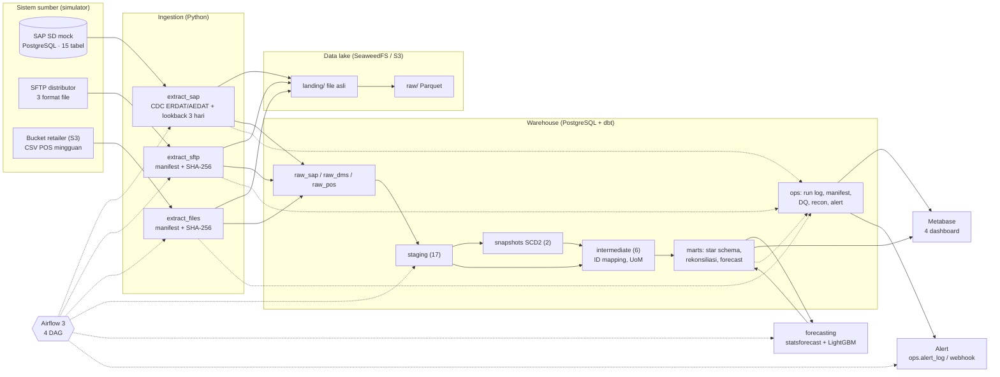

# Arsitektur

Dokumen ini menggambarkan sistem yang **sudah dibangun**. Rencana awal dan alasannya ada di [PLAN.md](PLAN.md), dan keputusan yang menyimpang dari rencana dicatat di [adr/](adr/).

## Gambaran besar

## Komponen

| Komponen | Teknologi | Port lokal (127.0.0.1) | Catatan |
|---|---|---|---|
| SAP mock | PostgreSQL 16 | 55432 | Akun ekstraksi read-only `sap_reader` |
| SFTP distributor | atmoz/sftp | 2222 | 1 akun per distributor + akun `ingest` read-only |
| Data lake & bucket retailer | SeaweedFS 4.48 (S3 API) | 8333 | Bucket `retailer-drop` (sumber) dan `lake` (landing + raw) |
| Warehouse | PostgreSQL 16 | 55433 | Juga menampung database aplikasi `airflow` dan `metabase` |
| Transformasi | dbt Core 1.11 + dbt_utils | — | 48 model, 2 snapshot, 4 seed, 130 tes, 6 analysis |
| Orkestrasi | Airflow 3.3 (LocalExecutor) | 8080 | Kode project dijalankan di virtualenv terpisah di dalam image |
| Forecasting | statsforecast, mlforecast, LightGBM | — | Hasil di schema `forecast`, dibaca dbt sebagai source |
| BI | Metabase 0.63 | 3000 | Koneksi lewat role `bi_reader` (hanya `marts`, `ops`, `forecast`) |

## Alur data & jadwal (WIB)

| Jam | DAG | Langkah |
|---|---|---|
| 05:00 | `simulate_source_systems` | Simulator mengirim data s/d kemarin (bukan bagian pipeline produksi) |
| 06:00 | `daily_commercial_pipeline` | migrate → extract SAP / DMS / POS (paralel) → `dbt build` → `notify` |
| Senin 08:00 | `forecast_weekly` | fitur → backtest + forecast → model dbt forecast + sanity test → `notify` |
| Minggu 03:00 | `weekly_reconcile` | Re-extract penuh SAP → `dbt build --full-refresh` → `notify` |

Semua `dbt build` memakai pool Airflow `dbt` (1 slot), supaya dua DAG tidak menulis tabel yang sama bersamaan.

## Lapisan data

| Lapisan | Schema | Prinsip |
|---|---|---|
| Landing | `lake/landing/...` | File asli tidak diubah; nama diawali hash, jadi kiriman ulang tidak menimpa versi lama |
| Raw | `raw_*`, `lake/raw/...` | Semua kolom bisnis disimpan sebagai `text`/`jsonb`, append-only. `raw_sap` = log perubahan (1 baris per versi, dedup hash) |
| Staging | `staging` | 1:1 dengan sumber: versi terbaru, tipe data, tanggal DATS, leading zero, versi file terakhir, dedup |
| Snapshot | `snapshots` | SCD Type 2 material & customer |
| Intermediate | `intermediate` | Cross-reference ID antar sistem, konversi UoM |
| Marts | `marts` | Star schema (unknown member `'-1'`), agregat, rekonsiliasi, forecast |
| Ops | `ops` | Run log, manifest file, watermark, hasil DQ & rekonsiliasi, karantina, alert |

## Prinsip desain

- **Idempotent di setiap langkah.** Ingestion memakai manifest file + hash baris + watermark yang hanya maju setelah commit. Fakta incremental memakai delete+insert per tanggal. Backfill 24 run terbukti tidak mengubah isi warehouse sama sekali.
- **Gagal secara terlihat, bukan diam-diam.** File yang melanggar kontrak skema dicatat `REJECTED`, ID yang belum ter-mapping masuk unknown member dan `ops.unmapped_ids`, dan setiap masalah berakhir di `ops.alert_log`.
- **Ambang berdasarkan profil data.** Ambang rekonsiliasi dan anomali volume diturunkan dari distribusi data aktual, bukan angka bulat (lihat [data_quality.md](data_quality.md)).
- **Semua kode bisa dibuat ulang.** Simulator deterministik dari seed, dashboard dibuat dari `dashboards/metabase/spec.py`, dan kamus data di-generate dari dbt.
- **Hak akses minimum.** Ekstraksi SAP read-only, akun SFTP `ingest` read-only, BI hanya membaca `marts`/`ops`/`forecast`, dan semua port hanya terbuka di localhost.
